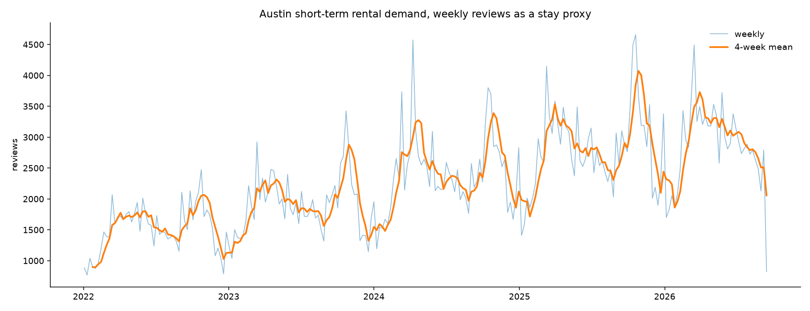
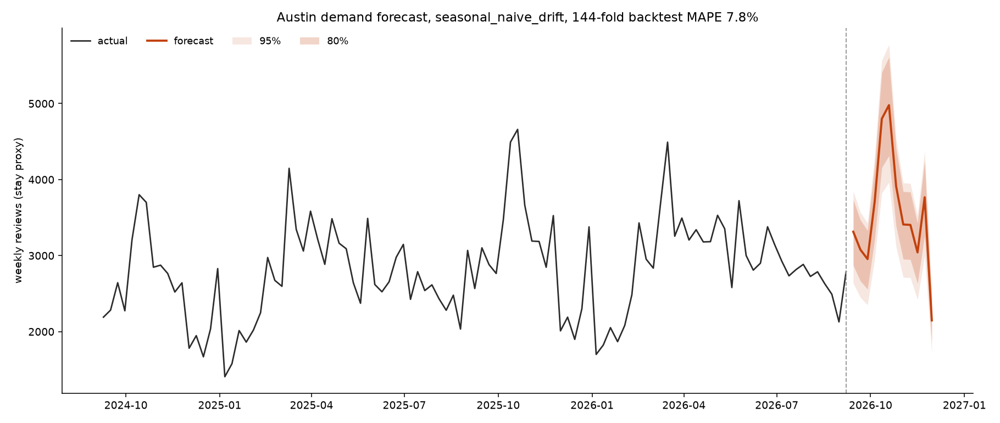
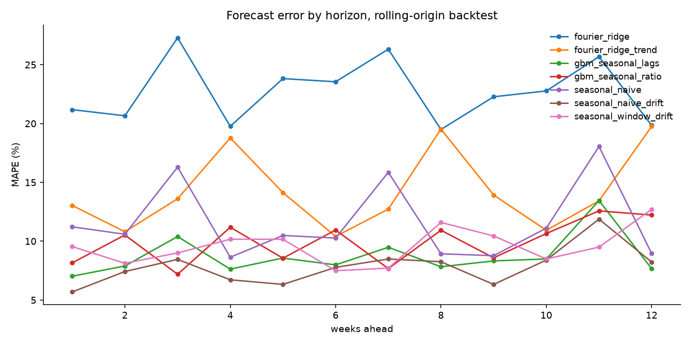

# Short-Term Rental Pricing & Demand Pipeline

An orchestrated pipeline that ingests Inside Airbnb data, models it into analytics
tables, and estimates occupancy, average daily rate, and RevPAR by neighborhood and
season for a short-term rental market.

> **Status:** complete. Orchestrated ingestion, a tested dbt modelling
> layer, and a backtested weekly demand forecast written back to the
> warehouse.

---

## Why this exists

Hotel revenue management has a standard metric set: occupancy, ADR (average daily
rate), and RevPAR (revenue per available room). Short-term rental data is rarely
analyzed that way, partly because the public data has no bookings in it.

It does have reviews. Reviews are a well-documented proxy for stays, which makes an
occupancy estimate possible, and from there ADR and RevPAR follow. This project
applies hotel revenue management metrics to a short-term rental market.

---

## Architecture

```
Inside Airbnb  (gzipped CSV, per city, per snapshot date)
       │
       ▼
Airflow: insideairbnb_ingest
       download → stage (Parquet) → merge (idempotent) → row-count check
       │
       ▼
DuckDB   raw_listings, raw_reviews
       │
       ▼
dbt      staging → intermediate → marts
         snapshot completeness and rate-usability tests
       │
       ├──▶  Occupancy / ADR / RevPAR by neighbourhood and month
       │
       ▼
Airflow: demand_forecast
       backtest 7 models (rolling origin) → fit champion → forecast 12 weeks
       │
       ▼
DuckDB   forecast_weekly, forecast_backtest   (keyed by training vintage)
       │
       ▼
dbt      mart_forecast_accuracy, mart_forecast_vs_actual
```

**Stack:** Python, Apache Airflow, DuckDB, dbt, pandas, scikit-learn

---

## Design notes

**Idempotent loads.** The merge task deletes the `(city, snapshot_date)` partition
before inserting. Rerunning a date never duplicates rows, which matters because
backfills get rerun.

**Skip, don't fail, on missing snapshots.** Inside Airbnb publishes on an irregular
cadence, so most months have no file. A 404 raises `AirflowSkipException` rather than
an error, so a backfill over a two-year range completes instead of filling the UI
with red.

**Schema drift is logged, not fatal.** Column names have changed across years of
snapshots. Missing columns are logged and the run continues, so older snapshots still
load.

**Column pruning at stage time.** The raw listings file has roughly 75 columns, most
of them free text. Trimming before Parquet keeps the warehouse small enough to work
with locally.

---

## Running it

Requires Python 3.9+. On Windows, run this under WSL.

```bash
git clone <this repo> && cd str-pipeline
python -m venv .venv && source .venv/bin/activate
pip install -r requirements.txt

export AIRFLOW_HOME="$PWD/.airflow"
export AIRFLOW__CORE__DAGS_FOLDER="$PWD/dags"
export AIRFLOW__CORE__LOAD_EXAMPLES=False
export STR_PROJECT_DIR="$PWD"

airflow standalone
```

The UI comes up at `http://localhost:8080`. The generated admin password is printed
in the terminal and also written to `.airflow/simple_auth_manager_passwords.json.generated`.

Unpause `insideairbnb_ingest` and it begins backfilling from the start date.

---

## Running the forecast

dbt and Airflow have incompatible dependency pins, so dbt lives in its own
virtualenv. The forecast runs in Airflow's, which is where scikit-learn is
installed.

```bash
source .venv/bin/activate

python -m forecast.explore          # inspect the series before modelling it
python -m forecast.run_backtest     # score every model, write the charts
python -m forecast.run_forecast     # ship the champion, write to the warehouse
```

Reruns are safe. `forecast_weekly` and `forecast_backtest` are written
delete-then-insert on their keys, so running twice produces the same row counts.

Then refresh the models that read them:

```bash
cd dbt && export DBT_PROFILES_DIR=$PWD
../.venv-dbt/bin/dbt build --select source:forecast+
```

Or trigger the `demand_forecast` DAG, which does both in order.

---

## Configuration

Set your city at the top of `dags/insideairbnb_ingest.py`:

```python
CITY_PATH = "united-states/tx/austin"
CITY_NAME = "austin"
```

Find the exact path on [insideairbnb.com/get-the-data](https://insideairbnb.com/get-the-data/):
right-click a `listings.csv.gz` link, copy the address, and take the segment between
the host and the snapshot date.

---

## Results

Data quality: the March 2026 snapshot is incomplete.
Listing counts hold around 11,100 to 11,300 across three snapshots but drop to 8,170 in March 2026. The drop is not proportional across room types, which rules out uniform sampling loss. Tracing individual listing IDs, 2,533 listings present in December are absent in March and present again in June, accounting for 82 percent of the shortfall. Listings do not exit and re-enter a market within a quarter, so the March snapshot is treated as incomplete and excluded from trend analysis rather than modeled on.

---

## Forecasting demand

Demand is the half of this data with real history. Rate comes from three price
snapshots; reviews run for years. So the forecast targets demand, and it works
weekly rather than monthly: 193 weeks from January 2023 is enough to fit and
backtest where 35 monthly points would not be, and weekly aggregation sharpens
the festival peaks from a smeared monthly bump into something a model can learn.



### What gets measured

Seven models, refit at 12 origins stepped four weeks apart, each forecasting 12
weeks ahead: 144 scored predictions per model, 1,008 in total. Scored on MAE
and MAPE plus skill against seasonal naive on identical folds.

| Model | MAE | MAPE | Skill vs naive |
|---|---|---|---|
| `seasonal_naive_drift` | 235 | 7.83% | **+34.4%** |
| `gbm_seasonal_lags` | 255 | 8.73% | +28.7% |
| `seasonal_window_drift` | 275 | 9.58% | +23.0% |
| `gbm_seasonal_ratio` | 288 | 9.94% | +19.6% |
| `seasonal_naive` | 358 | 11.60% | baseline |
| `fourier_ridge_trend` | 408 | 14.26% | -14.1% |
| `fourier_ridge` | 714 | 22.72% | -99.6% |

The shipped model has two parameters: last year's same week, rescaled by the
ratio of the recent 13 weeks to the same 13 weeks a year earlier. It beats
gradient boosting.



### Three results that matter more than the winner

**A fitted trend is actively harmful here, and it is measurable.** Both Fourier
variants lose to seasonal naive. The cause is survivorship: reviews rise from 31
in 2009 to 146,569 in 2025, and almost none of that is market growth, because a
listing delisted before the first snapshot never appears in the data at all.
Annualise 2026 and it lands near 2025's total, so the market is close to flat. A
model with a free trend parameter reads the backwards decay as forwards growth.

Running the same backtest from 2022 instead of 2023 confirms it from the other
side: every model that uses the extra year gets worse (gradient boosting 8.73%
to 9.28%, Fourier with trend 14.26% to 16.10%, Fourier without 22.72% to
31.05%), while the two models that never look back more than a year are
unchanged to the decimal. More history made the fitted models worse. That is why
the training window starts in 2023, and it is a tested choice rather than a
preference.

**The error is concentrated, and its largest cluster has a specific cause.** Six
weeks out of 56 carry 34% of all absolute error. The largest pair:

```
2026-03-09   actual 3,676   forecast 4,756   29.4% too high
2026-03-16   actual 4,492   forecast 3,834   14.6% too low
```

SXSW peaked the week of 10 March in 2025 and 16 March in 2026. A year-ago
lookup aims one week off and misses twice: high on the week the festival left,
low on the week it moved to.

**The obvious fix for that does not pay for itself.** `seasonal_window_drift`
blends the three weeks around the year-ago reference to absorb a one-week shift.
On a synthetic series built to contain timing drift it wins, 4.94% against
5.38%, so the mechanism is real. On this data it loses, 9.58% against 7.83%. It
improves exactly the horizons predicted (horizon 7 from 8.49% to 7.71%, horizon
11 from 11.88% to 9.50%) and degrades the ordinary weeks holding the other 66%
of the error by more than it gains. The model stays in the repo because the
negative result is the evidence for shipping the simpler one.



### Uncertainty

Intervals are empirical, taken from the distribution of actual over forecast
across all 144 backtest predictions: 80% at [0.87, 1.13], 95% at [0.80, 1.16].
They are pooled across horizons, and the run prints the diagnostic that
justifies pooling rather than assuming it: error growth is +0.002 log points per
week of horizon, which is flat. That flatness follows from anchoring on last
year rather than on recent momentum. If a future refresh changes it, the run
says so instead of quietly producing intervals that are too narrow three months
out.

### One-off events

April 2024 totals 15,650 reviews against March's 10,772, inverting the SXSW
pattern that holds in every other year, with the single busiest week of the year
falling on 8 April. That is the total solar eclipse, which put Austin in the path
of totality. Recurring events need no special handling, because the Fourier basis
carries anything date-anchored and SXSW and ACL land in roughly the same week
each year. A one-time shock is precisely what a periodic function cannot
represent, so it is the only entry in `forecast/events.csv`.

### Keeping the forecast accountable

`forecast_weekly` is keyed on `(model, trained_through, target_week)`. A rerun
replaces its own vintage; a run after a new snapshot lands adds a new one. Past
forecasts stay scoreable against what actually happened, which
`mart_forecast_vs_actual` does, including whether the outcome landed inside the
80% and 95% intervals. A forecast table holding only the current vintage can
never be evaluated, and a forecast nobody can score is not a forecast.

---

## What I would do differently at scale

<!-- Write this after weekend 3. Honest tradeoffs, not a feature list. Candidates:
     - DuckDB is right for a laptop and wrong for a team; what would change on Snowflake
     - snapshot-based sources vs. true incremental appends
     - where the occupancy estimate breaks down and what would validate it -->

_To be filled in._

**Forecast by neighbourhood, not just citywide.** The current forecast is one
series for Austin. A revenue manager prices a building, not a city, and the
neighbourhood panel already exists in `mart_neighbourhood_demand_monthly`.
Doing it properly means forecasting at both levels and reconciling them so the
parts sum to the whole, which is a real problem rather than a loop over ZIP
codes: thin cells are noisy, and an unreconciled set of local forecasts will not
add up to the citywide number anyone is held to.

**Get the event calendar right rather than inferring it.** The largest remaining
error cluster is festival timing drift, and the fix that works on synthetic data
loses on real data because it blurs every ordinary week to help a handful.
Aligning on actual published SXSW, ACL and Grand Prix dates would target only
the weeks that need it. That needs a maintained event calendar, including future
dates, which is exactly the kind of dependency worth being explicit about before
taking it on.
